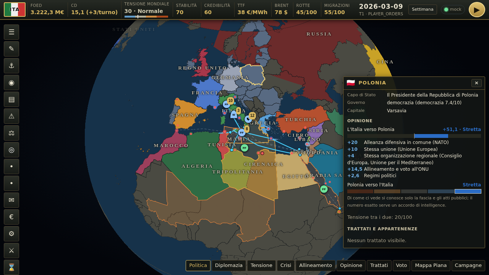
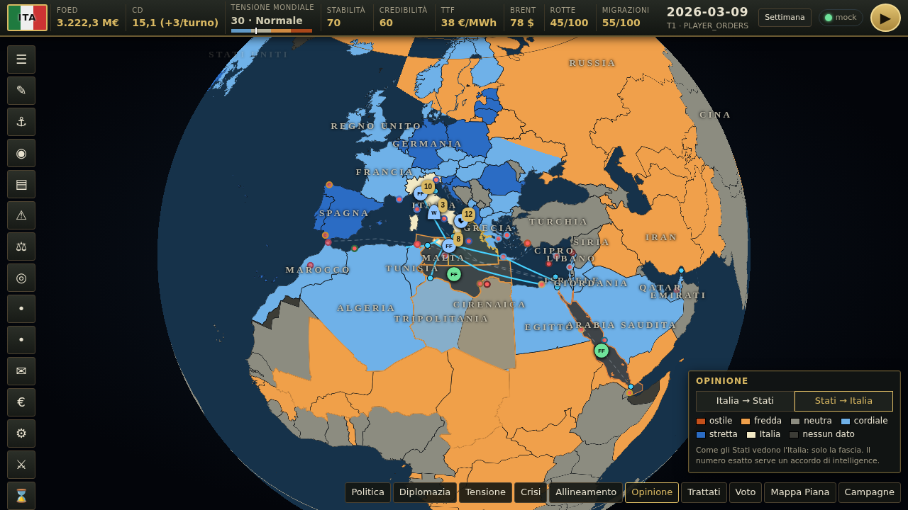
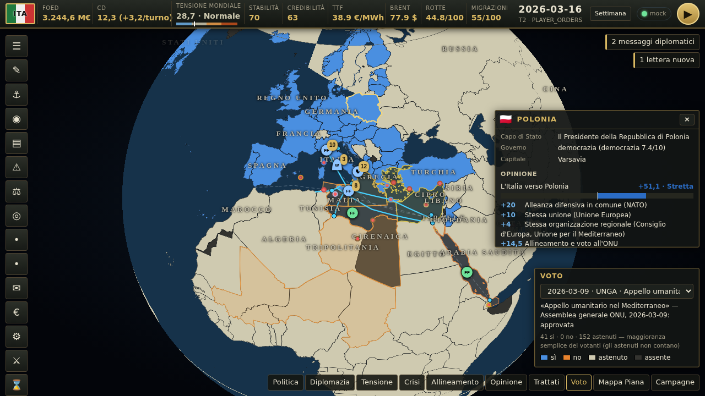

# Mare Nostrum — guida rapida

Wargame geopolitico a turni (Mediterraneo allargato, 2026). Tu comandi l'Italia; gli altri 25 Stati decidono con le regole deterministiche del motore (o, a scelta, con agenti LLM) e un LLM scrive lettere, notizie e briefing. Interfaccia derivata da World Monitor (AGPL-3.0).

## Installazione (≈5 minuti)
```bash
nvm use                       # Node 24 (.nvmrc)
npm ci --ignore-scripts       # dipendenze frontend
npm --prefix wargame-server install
```

## Primo turno con LLM finto (senza rete)
```bash
WARGAME_MOCK=1 npm run wargame:all    # server :8787 + frontend su http://localhost:5173/wargame.html
```
1. **Crea** una campagna.
2. Leggi il **Briefing**, poi apri **Console Ordini**: scrivi una direttiva ("Manda la Bergamini a pattugliare il Canale di Sicilia e chiedi alla Tunisia più controlli") → *Interpreta* → *Valida*, oppure usa il costruttore.
3. **Esegui turno**. Se un ingaggio supera la soglia CMO, apri **Coda CMO**: scarica il pacchetto, gioca su CMO e compila l'AAR (oppure *Risoluzione automatica*), poi **Prosegui**.

## Comandi dell'interfaccia
- **Clic su una pedina**: seleziona (pila: apre l'elenco). **Maiusc+clic**: selezione multipla.
- **Tasto destro su una zona di mare** con unità selezionate: ordine di pattugliamento (tratteggio oro sulla mappa).
- **Clic su un paese** (o pannello **Stati** ◎, con ricerca e tastiera): la **scheda paese**, uguale per tutti i 197 Stati del registro (vedi «Diplomazia: come si usa»). Dipendenze e Antartide non rispondono.
- In basso a destra: modalità mappa (politica, diplomazia, tensione, crisi, **allineamento**, **opinione**, **trattati**, **voto**) e globo/mappa piana. *Allineamento* colora ogni Stato per polo prevalente (blu Occidente, oro Cina, rosso Russia, grigio non allineato), più intenso = più allineato. Le altre tre sono spiegate sotto. Menu a icone a sinistra per tutti i pannelli; **▶** in alto a destra esegue il turno.

## Diplomazia: come si usa
Ogni numero ha i suoi motivi e ogni azione mostra costo e probabilità di riuscita **prima** di inviarla. Tutto viene dalla Knowledge dell'Italia o è pubblico (nebbia di guerra): di come gli altri ci vedono si conosce la **fascia** (ostile · fredda · neutra · cordiale · stretta), il numero esatto solo con un accordo di intelligence.



- **Scheda paese**: intestazione (bandiera, carica del capo di Stato, governo); **opinione nei due sensi** con la barra e l'elenco dei motivi come in HOI4 («+20 Alleanza difensiva in comune», «−8 Minaccia formale (ancora 8 turni)»); di chi ci vede si leggono la fascia e gli atti pubblici che pesano su di lui; **trattati e appartenenze** (in oro quelli in comune con l'Italia); **azioni** con il costo in CD e la ricarica — quelle non disponibili sono spente e dicono perché; per ogni **proposta di trattato** «Accetterebbe: sì/no (punteggio)» con i motivi (*perché*): è una **stima**, perché l'opinione dell'altro verso di noi è nota solo a fasce; **dati** (popolazione, PIL, spesa militare, nucleare, partner) con la data e il segno ≈ dove la confidenza è sotto 0,7.
- **Le azioni entrano nella bozza** (stesso schema degli ordini di sempre, niente invio diretto): si rivedono nella *Console Ordini* e partono con *Invia ordini* o ▶. Il capitale mostrato tiene conto della bozza.
- **Migliorare le relazioni**: costa 1 CD subito e 1 CD a turno, +2 a turno all'opinione dell'altro fino a +30; occupa uno slot (2–4 secondo la potenza). Slot e ultimatum con il conto alla rovescia sono nel pannello **Diplomazia**.
- **Modalità *Opinione***: colore per fascia (scala blu–arancio, leggibile anche da chi non distingue rosso e verde; la legenda scrive i nomi). L'interruttore *Italia → Stati* / *Stati → Italia* sceglie il verso.



- **Modalità *Trattati***: una linea per ogni partner dell'Italia, o del paese che hai selezionato; il colore dice la categoria (difesa, garanzia, accesso e basi, commercio, energia, migrazioni, altri), il tratto (pieno, tratteggiato, punteggiato) il gruppo, la linea chiara «proposto».
- **Modalità *Voto***: l'esito per Stato dell'ultima votazione in Assemblea o Consiglio (sì · no · astenuto · assente), con titolo, sede, data, regola e conteggi; il selettore sceglie un'altra votazione.



- **Pannello Istituzioni**: votazioni dell'ultimo turno e passate con conteggi e regola; *Mostra il voto sulla mappa* con un clic; *Proponi risoluzione* mette l'azione `RESOLUTION` nella bozza (costo della sede: UNSC 8, UNGA 6, UE 5, NATO 5, Lega Araba 4, UA 4).
- **Pannello Reazioni internazionali**: per ogni atto grave chi condanna, chi sostiene, chi tace, con le frasi delle cancellerie se ci sono; senza eventi dice «Nessuna reazione registrata».
- **Barra in alto**: il capitale diplomatico (valore e rendita a turno) e la tensione mondiale 0–100 con le quattro fasce del §6 (distensione, normale, alta, critica) scritte accanto al valore; il suggerimento (anche con la tastiera) elenca gli effetti di ogni fascia e le cause dell'ultimo turno.
- API di sola lettura (dalla Knowledge del giocatore): `GET /campaigns/:id/diplomacy/overview`, `GET /campaigns/:id/diplomacy/country/:actor` (id di fazione o ISO3), `GET /campaigns/:id/institutions/votes[?turn=]`. Le fasce bastano per la mappa: niente elenchi da 197 righe con testi lunghi.

## Con modelli reali (OmniRoute)
Gli agenti parlano con un solo endpoint OpenAI-compatible (OmniRoute); per ogni ruolo scegli un modello, un alias o una combo di OmniRoute.
```bash
cp wargame-server/.env.example wargame-server/.env   # imposta LLM_BASE_URL, LLM_MODEL e gli override per ruolo
npm run wargame:llm-check      # raggiungibilità, modelli per ruolo, JSON strutturato e latenza di ciascun modello
npm run wargame:smoke-llm      # 1 turno headless: chiamate, ok%, token e latenza per ruolo
npm run wargame:all
```
- Ruoli usati in modalità `rules` (predefinita, vedi «Come decidono gli stati»): `GM_NARRATOR` (briefing, debriefing, notizie), `INTEL_ANALYST`, `ORDER_PARSER` (Console Ordini), `DIPLOMAT` (lettere; senza `LLM_MODEL_DIPLOMAT` usa il modello di `FACTION_MAJOR`), `STRATEGIST` (direttive delle grandi potenze) e `CHANCERY` (frasi delle cancellerie) dal settore 11, `REPAIR` (correzione del JSON di questi ruoli). Solo in modalità `llm` anche `FACTION_MAJOR` (USA, FRA, TUR, RUS, CHN), `FACTION_MINOR` (le altre 9 fazioni «ai») e `REFLECTION`. Variabili: `LLM_MODEL` (default), `LLM_MODEL_<RUOLO>`, `LLM_TEMPERATURE_<RUOLO>`, `LLM_MAX_TOKENS_<RUOLO>`, `LLM_TIMEOUT_MS`.
- I modelli vengono copiati nella campagna alla creazione; per cambiarli in corsa: `POST /api/wg/campaigns/:id/config {"llm": {"faction_major": {"model": "..."}}}`.
- Se il modello non supporta `response_format: json_schema`, il client passa da solo a `json_object`; JSON invalido → 2 tentativi di repair → ordini di dottrina.
- `WARGAME_ALLOW_OFFLINE=1`: turni anche con i modelli spenti (dottrina); senza, ▶ risponde 503 se i modelli non rispondono (vedi «Stato dei modelli»).
- Consigli: in modalità `rules` un turno fa ~7–8 chiamate (3 di narrazione e notizie, 1 di intel, 3–4 lettere): con qwen3.5 4B/9B su 8 GB è circa un minuto, e i paesi in più non lo allungano. In modalità `llm` un modello da 30B+ con buon JSON per `FACTION_MAJOR` e `GM_NARRATOR`, 7–14B per gli altri ruoli; tieni `maxConcurrentAgents` a 2 (ogni turno: 14 decisioni di fazione + 14 riflessioni + 3–4 chiamate di narrazione e intel, ~36 chiamate).

## Stato dei modelli (pallino accanto a ▶)
Il server prova `LLM_BASE_URL/models` (timeout 3 s, risultato in cache 30 s) e la UI lo mostra nella barra in alto, aggiornato ogni 60 s e prima di ▶; clic sul pallino = ricontrolla subito.
- **Verde** «LLM»: i modelli rispondono e quelli configurati ci sono. **Giallo** «N mancanti»: il server risponde ma non elenca N modelli configurati (o la latenza supera 2 s): controlla i nomi nel tooltip (`ollama list`). **Rosso** «LLM spenti»: il server non risponde (PC con Ollama spento, indirizzo sbagliato, chiave rifiutata); ▶ è disattivato. «mock»: `WARGAME_MOCK=1`, nessuna rete.
- Tooltip: indirizzo, latenza, errore, modello per ruolo (quelli della campagna), modelli mancanti, ora del controllo.
- Se i modelli non rispondono, `advance` (▶), la creazione di una campagna, *Interpreta* e la bozza di lettera rispondono subito **503 `LLM_UNREACHABLE`** («I modelli non rispondono: accendi il PC con Ollama…») invece di giocare un turno tutto in dottrina.
- `WARGAME_ALLOW_OFFLINE=1`: si gioca lo stesso (le fazioni usano gli ordini di dottrina); il pallino resta rosso ma ▶ è attivo. Con `WARGAME_MOCK=1` il controllo è spento.
- API: `GET /api/wg/llm/status[?campaignId=…&fresh=1]` → `{ reachable, baseUrl, models: { ruolo: modello }, missing, listed, latencyMs, error, enforced, offlineAllowed, factionMode, budget }`, dove `budget` = `{ profile, callsPerTurn, endpoints: [{ rpm, rpd, inLastMinute, inLastDay, coolingMs }], campaign: { turn: { admitted, calls, skipped, rate429, fallbacks, tokensIn, tokensOut, byRole, skippedByPriority, remaining }, today, turns, days } }` (contatori per turno e per giorno; il tooltip del pallino ne mostra una riga). In modalità `rules` `models` elenca solo i ruoli che usano ancora l'LLM (niente `faction_major`, `faction_minor`, `reflection`).

## Gemini, OmniRoute e Ollama: profili di provider e budget di chiamate
Con la modalità `rules` un turno chiede al modello solo testi e direttive: bastano ~10 chiamate. Per usare un provider con quote (Gemini gratuito, o una combo di OmniRoute) il gioco tiene un **budget** e sceglie i modelli con un **profilo**. Dettagli di funzionamento in `docs/wargame/AGENTS.md` («Budget delle chiamate, profili di provider e ruoli del settore 11»).
```bash
# in wargame-server/.env: scegli UN profilo (e togli le righe LLM_MODEL_*, che vincono sul profilo)
LLM_PROFILE=gemini            # oppure locale, omniroute
GEMINI_API_KEY=…              # solo in .env, mai nei profili
LLM_BUDGET_CALLS=10           # chiamate per turno (0 = solo testi deterministici)
npm run wargame:llm-check     # prova ogni modello del profilo (principali e ripiego)
```
- **Gemini** (`llm-profiles/gemini.json`): endpoint OpenAI-compatibile di Google AI Studio (`https://generativelanguage.googleapis.com/v1beta/openai`), chiave in `GEMINI_API_KEY`. **Gemini 2.5 Flash** per `diplomat`, `gm_narrator` e `strategist`, **2.5 Flash-Lite** per gli altri ruoli; ognuno è il ripiego dell'altro su 429. Ragionamento al minimo con `"extraBody": {"reasoning_effort": "none"}`: è il parametro che l'endpoint OpenAI-compatibile accetta per la famiglia 2.5 (documentazione Google: con `reasoning_effort: "none"` il ragionamento si spegne sui modelli 2.5, mentre non si può spegnere su 2.5 Pro né sui modelli 3, per cui servono `"minimal"` o `"low"`; `reasoning_effort` si traduce in `thinking_budget` per i 2.5 e in `thinking_level` per i 3). Se passi a un modello della famiglia 3 cambia `reasoning_effort` nel profilo. Gli `rpm` del file (10 per Flash, 15 per Flash-Lite) e `LLM_RPD` vanno adattati ai **limiti del tuo piano**: i limiti del piano gratuito cambiano e le fonti non concordano (circa 10–15 richieste al minuto e da 250 a 1.500 al giorno per modello); verificali in AI Studio. Con 10 chiamate a turno il piano gratuito dà più di 100 turni al giorno. **Attenzione**: nel piano gratuito Google può usare richieste e risposte per migliorare i modelli.
- **OmniRoute** (`llm-profiles/omniroute.json`): un solo `LLM_BASE_URL` e due combo, `wargame-strong` (es. Gemini Flash → Mistral → qwen locale) per lettere, narratore, direttive e potenze e `wargame-light` per il resto; il ripiego a cascata lo fa la combo. Imposta `LLM_RPM` al **limite più basso** tra i provider della combo (predefinito 8). Chiave (se serve) in `LLM_API_KEY`.
- **Ollama** (`llm-profiles/locale.json`): come prima (`wg-qwen3.5-9b` per potenze, lettere, narratore e direttive, `wg-qwen3.5-4b` per il resto, `reasoning_effort: none`), senza limiti di richieste; `OLLAMA_BASE_URL` se non è `localhost:11434`.
- **Profilo tuo**: un file `llm-profiles/<nome>.json` o la variabile `LLM_PROFILE_JSON`; per ogni ruolo un elenco di `{baseUrl, model, extraBody, rpm, rpd, apiKeyEnv}` (il primo è il principale). `LLM_MODEL_<RUOLO>` resta valido e vince sul profilo; senza `LLM_PROFILE` tutto come prima.
- **Budget**: `LLM_BUDGET_CALLS` per turno (10 nelle campagne a regole, nessun tetto in modalità `llm`). Quando finisce, ogni ruolo usa il suo testo deterministico, nell'ordine di priorità: Console Ordini e briefing, lettere con il giocatore, notizie, direttive, reazioni delle cancellerie, lettere tra IA. `LLM_RPM`/`LLM_RPD` limitano le richieste al minuto e al giorno per modello (si aspetta un posto fino a `LLM_MAX_WAIT_MS`, 45 s); su 429 si passa al modello successivo del profilo, e se sono tutti in pausa il turno si completa con i testi deterministici. Le risposte si ricordano per campagna (stessa richiesta = stessa risposta, anche dopo un riavvio).
- **Misure**: `npm --prefix wargame-server run bench:models -- <campagna> --profile gemini,locale` prova `strategist` e `chancery` su ogni profilo (tempo, token, ripieghi, 429); `npm --prefix wargame-server run playtest -- --turns 10` riporta chiamate per ruolo e turno, saltate, ripieghi e token (con un server `LLM_BUDGET_CALLS=10`).

## Console Ordini: da testo a ordini
*Interpreta* (`POST /campaigns/:id/orders/parse`) passa per quattro fasi; tutte tranne la seconda sono deterministiche.
1. **Nomi → id, prima dell'LLM** (`engine/names.ts`): unità proprie per nome, nome breve, sigla e classe, con o senza articolo («la Bergamini», «l'Andrea Doria» → ITA-D553, «il Todaro» → ITA-S526, «F 590»), zone e paesi con gli alias italiani di `scenarios/<scenario>/names.json` («Mar Ionio»/«Ionio» → IONIO, «Tunisia» → TUN, «Libia orientale»/«Cirenaica»/«Bengasi» → LBY_LNA, «Libia occidentale»/«Tripolitania»/«Tripoli» → LBY_GNU). Il modello riceve il testo con l'id tra parentesi quadre («la Bergamini [ITA-F590]») e una tabella nome → id. Gli alias di più voci non si sostituiscono («Libia» da sola → ambiguità GNU/LNA).
2. **LLM** (ruolo `ORDER_PARSER`): stesso elenco di campi degli ordini delle fazioni (`prompts/order-fields.md`), solo id delle AZIONI LECITE. **Regola principale** in testa al prompt: se il testo ha l'id di una tua unità tra parentesi quadre, un ordine in `orders.military` con quell'id; `zoneStances` solo se il testo non nomina unità («più presenza nel Canale di Sicilia»: il motore sceglie le unità come per le fazioni IA). Cyber solo se il testo parla di cyber/hacking, come CYBER_OP (non ISR) con `effect` dal testo: spionaggio → `espionage`, attacco/sabotaggio → `disruption`, difesa delle reti → `defense_hardening`. Niente lettere dal parser (hanno il loro pannello).
   - **Schema limitato** (niente JSON troncati): `maxItems` su ogni lista (4 ordini militari, 3 diplomatici, 1 dichiarazione, 3 ambiguità, 5 unità per ordine…) e `maxLength` su ogni testo libero (`message` 160, `ambiguities` 150, identificatori 24…), mandati al modello (`keepLengths`: con Ollama/llama.cpp la grammatica ferma il testo). Il caso peggiore dello schema (`maxJsonChars`: ~4.900 caratteri) sta sotto i 2000 token di `LLM_MAX_TOKENS_ORDER_PARSER` anche a 2,5 caratteri per token. In lettura le liste più lunghe si tagliano.
3. **Unità nominate e completamento** (`engine/parse-review.ts` → `finishParsed`):
   - **Le unità nominate vanno per prime nelle posture.** Se il modello risponde con una postura invece che con un ordine (errore tipico di qwen3.5 4B/9B: «CANALE_SICILIA patrol» per «Manda la Bergamini a pattugliare il Canale di Sicilia»), le unità riconosciute nel testo e non usate da un ordine esplicito passano a `translateStances` come `prefer`: entrano per prime, prima delle candidate normali, e contano nell'intensità (la Bergamini al posto della fregata più vicina). Una nominata deve essere adatta: della fazione, non distrutta né danneggiata, pronta o fuori base, prontezza ≥ 50, niente navi nelle zone terrestri; per `withdraw` fuori base. Per le nominate non contano gli scaglioni di tipo né `busyElsewhere` (il sottomarino Todaro nominato pattuglia anche se la postura sceglierebbe una fregata, o se aveva un altro compito); il budget sì. Con più posture ogni nominata va in quella della zona più vicina tra quelle a cui è adatta; con una sola vanno tutte lì (anche oltre l'intensità). Le nominate non adatte restano fuori, con il motivo nelle ambiguità («postura — unità nominata ITA-F590: danneggiata, va in riparazione»). Le fazioni IA non passano `prefer`: le loro decisioni e il replay non cambiano.
   - **Né ordine né postura → completa il motore.** Se il testo ha un verbo di movimento o presenza, unità nominate e una sola zona nominata, e dopo le posture nessun ordine impiega quelle unità, il motore aggiunge l'ordine: «pattuglia» → PATROL, «dimostrazione di forza» → SHOW_OF_FORCE, «scorta» → ESCORT «convoglio ZONA», «rientra/rientrare» → RETURN_TO_BASE (anche senza zona), altrimenti PRESENCE, ROE come nelle posture. Solo unità adatte; niente completamento con due zone o con «non»/«mai». Allo stesso modo, un testo che chiede un'operazione cyber contro una sola fazione straniera senza che il modello dia la CYBER_OP la ottiene dal motore (effetto dal testo; spionaggio se non è detto). Ogni ordine completato è scritto nelle ambiguità («Ordine completato dal motore: … controlla che sia quello che volevi») e passa dal validatore come gli altri.
4. **Controlli del motore** (`reviewParsed`), come avvisi (non bloccano la bozza): verbo di movimento («pattuglia», «porta», «manda», «schiera», «rientra», «scorta», «dimostrazione di forza») senza un ordine con unità, zona o unità nominate e non usate (un rientro alla base copre la zona da cui si rientra; i rientri dei logorati e le riparazioni che il motore aggiunge comunque non contano come impiego); **⚠ azione ostile verso un alleato** (CYBER_OP disruption, THREAT, SANCTION, BLOCKADE, STRIKE verso NATO/UE o fiducia ≥ 40); verbo diplomatico senza l'azione corrispondente. **CYBER_OP non chieste**: se il testo non parla di cyber o di operazioni informatiche (`CYBER_WORDS`) le CYBER_OP del modello escono dalla bozza prima di tutto il resto (`dropUninvitedCyber`), con una riga nelle ambiguità («CYBER_OP (…) contro … tolta dalla bozza…»). Una CYBER_OP chiesta ma con un `target` che non è una fazione (es. una zona come MAR_ROSSO) resta un errore del validatore.
Sotto il pulsante compaiono i nomi riconosciuti e le posture da cui vengono gli ordini; le ambiguità (compresi gli ordini completati dal motore) in basso, gli avvisi nella validazione.

## Come decidono gli stati (`WARGAME_FACTION_MODE`)
Le fazioni non giocate da te decidono con il **decisore a regole** del motore (`engine/policy.ts`), senza LLM: un turno con i modelli locali passa da 4–5 minuti a circa uno, e aggiungere uno stato non lo allunga. L'LLM resta solo per scrivere: lettere e risposte (`DIPLOMAT`), notizie e briefing (`GM_NARRATOR`, `INTEL_ANALYST`), interpretazione della Console Ordini (`ORDER_PARSER`).
- **Modalità**: `WARGAME_FACTION_MODE=rules` (predefinita) o `llm`, copiata in `campaign.config.factionMode` alla creazione (le campagne create prima usano quella del server; il replay usa quella della campagna). In `rules` le fazioni IA nascono con `controller: 'scripted'`; in `llm` l'LLM decide per le fazioni con controller «ai» come prima, mentre le «scripted» (i paesi aggiunti) decidono comunque a regole. `sim` e `balance` accettano anche `--mode rules|llm`.
- **Stesso percorso delle decisioni LLM**: `decideByRules` restituisce lo stesso `DecisionOutput` (posture per zona, diplomazia, CYBER_OP, intenzioni di lettera), che passa dal traduttore delle posture, dallo stesso validatore del giocatore, dallo scarto degli ordini impossibili e dal registro (`decisions/…/{F}.json` con `model: "regole"`).
- **Nebbia di guerra**: il decisore legge solo la `FactionKnowledge` della fazione (unità proprie, crisi note, accordi visibili, `incidents` = atti ostili visti nel turno precedente, `ownRelations` = la propria riga di fiducia e tensione) e la geografia pubblica dello scenario (zone, basi, infrastrutture). Una lettera minacciosa riservata tra altri, o un'operazione coperta non attribuita, non la vede e non la fa reagire.
- **Casualità**: solo dal dado registrato del motore (`ctx.rng`, tiri «regole F: …» in `rolls/`); stesso seed → stesse decisioni.
- **Profilo** (`policy` in `world.json`, schema `FactionPolicy`): `aggressiveness`, `riskTolerance`, `cyberPropensity` (0–1), `diplomacyStyle` (conciliatory | formal | assertive), `zoneInterests` (zona → 0–1), `maxStancesPerTurn`. Ogni blocco ha una `_nota` con il perché dei valori.
- **Regole a punteggio**, in ordine stabile (parametri in `PARAMS.policy`, ciascuno col suo perché): 1) unità logorate e danneggiate a casa (lo fa il traduttore); 2) **linee rosse** superate nel turno prima → la risposta scritta nel profilo, mappata su posture e azioni nella zona della condizione («Mobilitazione navale» → `show_of_force` 3; «Strike preventivo» → dimostrazione di forza e mai uno strike; «minaccia» → THREAT; «sanzioni» → SANCTION; «Consiglio di sicurezza» → RESOLUTION al CdS per i suoi membri, all'AG per gli altri; «ultimatum» → ULTIMATUM, solo qui); 3) **atti subiti** (minaccia, sanzione, blocco, scontro, strike, cyber o SOF attribuiti): profili aggressivi (≥ 0,5) → dimostrazione di forza nella zona dell'atto o sanzioni, con probabilità = aggressività (tiro registrato, smorza le spirali), prudenti → démarche o canale riservato; sempre una lettera `firm`; 4) **crisi** nelle zone d'interesse: pattugliamento (non coinvolti) o presenza (coinvolti) con intensità da escalation × interesse; da escalation 6 i profili aggressivi coinvolti fanno una dimostrazione di forza, i poco aggressivi sopra la loro soglia (5 + rischio × 3) solo un pattugliamento leggero e distensione (REASSURANCE o BACKCHANNEL verso la parte più tesa, da 8 una proposta di tregua) con lettera conciliante; 5) **obiettivi** non raggiunti all'ultima verifica: postura nella zona o azione verso la fazione che li riguarda; 6) **alleati sotto pressione**: scorta al traffico nella zona dell'atto (se d'interesse) o rassicurazione, per atti senza zona solo dagli alleati stretti; 7) **cyber** solo verso avversari (fiducia ≤ −20, tensione ≥ 50), mai verso alleati, con probabilità `cyberPropensity × cyber.offense / 10`, al massimo una al turno; poi (con il capitale diplomatico: ciò che non si può pagare o è in ricarica non si propone) relazioni — «migliorare le relazioni» con i partner dall'opinione bassa, ripristino dei rapporti ridotti —, risposte agli accordi proposti con `acceptance()`, pattugliamento di routine della zona d'interesse non coperta e ritiro dalle zone che nessuna regola chiede più. Una postura che le proprie unità non possono eseguire ripiega (dimostrazione di forza → presenza → pattugliamento) o lascia il posto alla successiva.
- **Motivazioni**: ogni decisione ha `rationale` (regola + frase costruita senza LLM, es. «Risposta alla minaccia di TUR in EGEO: dimostrazione di forza»), nel registro e nel pannello **Post-mortem** sotto l'intento.
- **Lettere**: le intenzioni vengono dalle regole (lettera ferma a chi ti ha minacciato, conciliante nella distensione, cordiale per un obiettivo di fiducia) e da `letter-triggers.ts`, dentro `lettersPerTurn`; il testo lo scrive `DIPLOMAT`. Le risposte alle lettere del giocatore restano sempre.
- **Memoria**: in modalità `rules` niente `REFLECTION`: una riga deterministica per turno («T3: subito le sanzioni di USA; fatto: …») più i torti subiti, per il consigliere che scrive le lettere.
- **Replay**: le decisioni a regole si ricalcolano con lo stesso dado e si confrontano con quelle registrate; se una non torna il replay si ferma con `REPLAY_DIVERGENT`.

## Paesi
Fazioni con controller «ai» (in modalità `llm` le decide l'LLM): USA, FRA, TUR, RUS, CHN (maggiori), GBR, GRC, EGY, ISR, ALG, TUN, LBY_GNU, LBY_LNA, IRN. Paesi «scripted» (sempre a regole): Spagna (ESP), Marocco (MAR), Malta (MLT), Cipro (CYP), Libano (LBN), Siria (SYR), Giordania (JOR), Arabia Saudita (SAU), Emirati Arabi Uniti (ARE), Qatar (QAT), Germania (DEU).
- Unità solo dove c'è peso navale o aereo nel Mediterraneo allargato, pochi mezzi da fonti pubbliche: Juan Carlos I (Rota), Álvaro de Bazán (Ferrol, fuori mappa), Isaac Peral (Cartagena), Ala 11 Eurofighter (Morón); Mohammed VI e Tarik Ben Ziyad (Ksar Sghir), F-16 Block 52 (Ben Guerir); P61 e P62 (La Valletta); Al Riyadh e Makkah (Gedda), Typhoon (Taif); Baynunah (Abu Dhabi), F-16E/F (Al Dhafra); Al Zubarah (Umm Al Houl), Rafale (Dukhan); Ludwigshafen am Rhein e Sachsen-Anhalt (supporto UNIFIL a Limassol). Cipro, Libano, Siria e Giordania non hanno unità: agiscono con la diplomazia.
- Accordi: Spagna e Germania nella NATO; clausola di mutua assistenza UE (art. 42.7 TUE) per ITA, FRA, GRC, ESP, DEU, MLT, CYP; Turchia–Qatar e Grecia–Emirati (difesa).
- I capi si indicano solo con la carica («Il Re del Marocco», «L'Emiro del Qatar»; le lettere aprono con «Maestà» e «Altezza»); la fazione LNA si chiama «Libia (LNA, Bengasi)».

## Come le fazioni usano le forze: posture per zona
Un modello piccolo (es. `qwen3.5:4b`) non riesce a scrivere ordini con gli id di unità giusti; per questo la decisione di fazione ha il campo `zoneStances`: la fazione (l'LLM o le regole) dice **dove** e **come**, il motore sceglie **quali** unità (`engine/stances.ts`, deterministico).
- `zoneStances: [{ zoneId, stance, intensity }]`, al massimo 4 per turno. `stance` → ordine: `patrol` → PATROL (WEAPONS_TIGHT), `presence` → PRESENCE (WEAPONS_HOLD), `show_of_force` → SHOW_OF_FORCE, `escort_shipping` → ESCORT «convoglio ZONA», `blockade` → BLOCKADE, `air_defense` → AIR_DEFENSE (alert high), `withdraw` → RETURN_TO_BASE delle unità schierate in quella zona. `intensity` 1/2/3 → al massimo 1/3/5 unità.
- Il motore sceglie unità pronte o già schierate lì, non impegnate altrove, con prontezza ≥ 50 e del dominio giusto (navi in mare, `sam_battery` per prima nella difesa aerea, niente navi nelle zone terrestri): prima quelle già nella zona, poi le più vicine, poi per id; nel budget (costano solo le unità che partono dalla base). Le unità logorate (prontezza < 35) rientrano e quelle danneggiate vanno in riparazione comunque.
- Gli ordini tradotti si aggiungono agli ordini militari **prima** della validazione: stesso validatore e stesso scarto degli ordini impossibili del giocatore. `orders.military` resta per chi vuole un ordine preciso a un'unità (il giocatore, modelli grandi).
- Registro: `decisions/…/{F}.json` contiene `zoneStances` e `stanceOrders` (quale ordine viene da quale postura; `worn` = rientro dei logorati); le posture non tradotte sono in `validation.errors` («postura — …»). Il replay rilegge gli ordini già tradotti.
- **Tra un turno e l'altro** un'unità con un compito (PATROL, PRESENCE, SHOW_OF_FORCE, ESCORT, BLOCKADE, AIR_DEFENSE, MOVE) **continua quel compito** finché un ordine non la richiama: resta `deployed` nella zona con `currentTask`, paga la quota operativa (`chargeOperations`), perde 4 punti di prontezza a turno (`applyAttrition`) e, sotto 35, il traduttore la fa rientrare comunque (`worn`); le avarie per usura la mandano in riparazione. Se un'unità non arriva in un turno resta `transit` e **prosegue da sola** verso la zona del compito all'apertura del turno dopo (`continueTransit` in `engine/movement.ts`). Per le posture: un'unità fuori base impegnata in un'altra zona (anche se ancora in viaggio) non viene distolta (`busyElsewhere`); una postura nella zona del suo compito la **conferma** (è la prima scelta, costo zero) e `withdraw` richiama anche chi ci sta ancora andando. Per questo gli ordini alle unità calano nei primi turni: molte unità restano impegnate nel compito del turno prima e le nuove posture in altre zone trovano meno unità libere (nel playtest: «unità IA impegnate» e «posture emesse / tradotte / senza unità»).
- Nel prompt le AZIONI LECITE includono `unitsPerSeaZone` (quante unità la fazione può impiegare in ogni zona di mare). Parametri in `PARAMS.stances`.

## Crisi: escalation e distensione
Le crisi (0–10) salgono per deriva casuale (2d6), eventi casuali della zona e ordini (blocchi, strike, ingaggi) e scendono con la calma, gli accordi e la diplomazia (`engine/crises.ts`, parametri in `engine/params.ts`).
- **Tetto dagli ordini**: al massimo +1 per crisi per turno dovuto agli ordini (`crisisOrderCapPerTurn`), qualunque sia il numero di blocchi, strike e ingaggi; le singole azioni continuano a spostare fiducia e tensione.
- **Saturazione degli eventi casuali**: un incidente alza la crisi con probabilità 1 − escalation/12 (`randomEventSaturation`); l'evento resta nelle notizie e negli indicatori.
- **Distensione**: ogni REASSURANCE, BACKCHANNEL, lettera cordiale o conciliante e accordo accettato tra due fazioni coinvolte in una crisi aggiunge +15% (fino a 3 azioni, `detenteCoolBonus`) alla probabilità che la crisi scenda di 1 nel turno dopo, anche se nel turno precedente era salita.
- **Pressione migratoria**: tende a 15 + 6 × escalation di SAHEL_MIG, −10 per ogni accordo migratorio attivo (`PARAMS.migration`); le ondate casuali la spingono su per un turno e poi rientra.

## Opinione asimmetrica e tensione mondiale
Le relazioni tra Stati non sono più una matrice simmetrica: `opinion(A→B)` = quanto A apprezza B (−100…+100) = **base** + Σ **modificatori**, e ogni numero ha un elenco di motivi (`engine/opinion.ts`, piano in `docs/wargame/DIPLOMAZIA.md` §5–6).
- **Base** (statica, dai dati del mondo, in cache, mai negli snapshot): alleanza difensiva in comune (+20), stessa unione (+10) o organizzazione regionale (+4), blocchi contrapposti (−10), vicinanza di allineamento e di voto ONU (±20), somiglianza di regime (±6), dipendenza commerciale di A da B (≤ +12) e storia della coppia (`pairs.json`). Pesi in `PARAMS.opinion.base`; i 40 casi di riferimento sono nel test `opinion-plausibility`.
- **Modificatori**: un'azione di A verso B cambia **come B vede A** (`opinion(B→A)`), non come A vede B. Ogni modificatore ha tipo, etichetta, decadimento a settimana (verso 0; il turno mensile vale 4 settimane) e causa. Gli alleati stretti di B ne ricevono il 30%; scontri e accordi accettati valgono per entrambe le parti. Le sanzioni sono un solo modificatore per coppia che si accumula (tetto −40) e, revocate, diventano un residuo che decade. Il tipo si deduce dalla nota di `ctx.relate()` (tabella in `engine/opinion.ts`); chi chiama non cambia.
- **Decadimento**: nella fase OPEN i modificatori vanno verso 0 e quelli esauriti si tolgono con **un solo evento** `OPINION_DECAYED`; la tensione di coppia torna verso il suo fondo di 0,5 punti a settimana.
- **Tensione di coppia**: resta simmetrica, memorizzata solo dove diversa dal **fondo** (il maggiore tra la tensione strutturale dello scenario, 20 se non indicata, e 3 × l'escalation della crisi più grave in comune).
- **Valori derivati**: `relations[a][b].trust` e `.tension` restano per le coppie di fazioni, ricalcolati dal reducer da `opinionOf` e dalla tensione di coppia: decisore a regole, Console Ordini, lettere e UI non cambiano. Il codice nuovo usa `opinionOf(state, a, b)`.
- **Stato e eventi**: `WorldState.diplomacy = { modifiers, tension, tensionBase }` (sparso: nel playtest 449 modificatori e 19 tensioni, 83 kB), eventi `OPINION_MODIFIER`, `OPINION_DECAYED`, `TENSION_CHANGED`, `WORLD_TENSION_CHANGED`; `RELATION_CHANGED` resta leggibile per le campagne vecchie ma non si emette più. Chi legge gli atti (incidenti, inneschi delle lettere, minacce da verificare, distensione) usa `diploActs()`.
- **Nebbia**: la Knowledge ha solo la riga della fazione (`ownRelations`: la sua opinione degli altri e la tensione) più `opinionOfMe`, come gli altri la vedono, **a fasce** (ostile < −50 ≤ fredda < −15 ≤ neutra < 15 ≤ cordiale < 50 ≤ stretta); il numero esatto solo con un accordo di intelligence attivo. Le coppie tra terzi non ci sono.
- **Scenario e campagne vecchie**: in `med-2026` le 195 coppie diventano modificatori permanenti «Situazione 2026» rispetto alla base (i valori iniziali tra fazioni restano quelli tarati); le coppie non elencate hanno l'opinione di base dei dati. Una campagna creata prima si apre comunque: in lettura (`store/migrations`) fiducia − base = modificatore permanente «Storia recente» e le tensioni attuali vanno nella mappa sparsa, con gli stessi `trust` e `tension` di prima.
- **Tensione mondiale** (`globalIndicators.worldTension`, 0–100, iniziale 30): a fine turno si avvicina del 30% al valore di regime delle crisi (8 + 3,5 × escalation massima + 1,5 × media: al massimo 63) e ogni incidente del turno aggiunge la sua quota (scontro +3, strike +6, blocco +2, minaccia +1; tetto +15); senza incidenti scende da sola e non resta a 100. Un evento `WORLD_TENSION_CHANGED` con le cause; Brent, TTF e rischio navale si muovono poco. Gli effetti sulle azioni (costi in CD, accettazione, legittimità) sono nella sezione sotto.
- **Bilanciamento**: `npm --prefix wargame-server run balance` riporta anche la deriva media della fiducia tra fazioni (obiettivo ≤ ±10) e l'andamento della tensione mondiale.

## Capitale diplomatico, trattati e votazioni
Le azioni diplomatiche costano **capitale diplomatico (CD)** e hanno una ricarica; gli accordi si accettano con un punteggio spiegabile e le risoluzioni si votano con le regole vere delle istituzioni (settore 3 di 6, `docs/wargame/DIPLOMAZIA.md` §7–§9).
- **CD** (`engine/diplo-actions.ts`, `PARAMS.diplo.capital`): ogni fazione (non i blocchi) ha una rendita a settimana = max(0,5; log₁₀(PIL in mld $) − 0,35 + 2 se membro permanente del CdS) × credibilità/60 (tra 0,5 e 1,5): con credibilità 60 Italia ≈ 3,0, USA ≈ 6,1, Cina ≈ 5,9, Malta ≈ 1,0. Si parte da 4 settimane di rendita, tetto 100, il turno mensile vale 4 settimane. La rendita è **un solo evento `CAPITAL_CHANGED`** per turno (fase OPEN); le spese sono eventi con `causedBy` dell'ordine. Il validatore somma i costi della bozza e rifiuta ciò che non si può pagare o è in ricarica.
- **Catalogo** (una tabella sola per validatore, decisore a regole, Console e UI; `GET /api/wg/diplomacy/catalog`). ×2* = costo doppio per le democrazie con tensione mondiale < 25 (azioni coercitive, §6). Ricarica N = si può ripetere verso lo stesso destinatario da T+N (1 = una volta a turno).

| Azione | Costo (CD) | Ricarica (turni) | Prerequisiti | Effetti |
|---|---|---|---|---|
| Démarche (`DEMARCHE`) | 1 | 1 | — | opinione del destinatario −2 (decade), tensione +3 |
| Minaccia (`THREAT`) | 3 ×2* | 2 | — | opinione −6, tensione +10, alleati del destinatario 30%; minaccia da verificare (credibilità) |
| Rassicurazione (`REASSURANCE`) | 1 | 1 | — | opinione +3, tensione −5; raffredda le crisi comuni |
| Canale riservato (`BACKCHANNEL`) | 1 | 1 | — | opinione +2, tensione −2, riservato; raffredda le crisi comuni |
| Lettera (`LETTER`) | 1 | — | destinatario con un capo di Stato (non un blocco), al massimo 2 a turno per l'umano | dal tono: da +3 (conciliante) a −5 (minacciosa); una minacciosa è una minaccia da verificare |
| Migliorare le relazioni (`IMPROVE_RELATIONS`) | 1 | — | uno slot libero (2–4 secondo la rendita), non già in corso | continuativa: 1 CD a turno, +2 a turno all'opinione del destinatario fino a +30; occupa uno slot (2–4 secondo la potenza) |
| Smettere di migliorare le relazioni (`STOP_IMPROVE`) | 0 | — | un miglioramento in corso | libera lo slot; il vantaggio accumulato decade di 0,5 a settimana |
| Proposta di trattato (`PROPOSE_AGREEMENT`) | ceasefire 2, migration 3, energy 3, trade 3, non_aggression 3, arms_sale 4, intel_sharing 4, defense_cooperation 5, defense 6, guarantee 5, military_access 5, basing 5, secret 3 | 2 | nessun embargo sulle armi per `arms_sale`; relazioni non rotte | gli Stati del mondo rispondono subito con acceptance(), le fazioni nel turno dopo; le accettate danno «Trattato attivo» +10 |
| Risposta a un trattato (`RESPOND_AGREEMENT`) | 0 | — | accordo proposto alla fazione | accetta, respinge o controproposta |
| Sanzioni (`SANCTION`) | 6 ×2* | 3 | — | opinione −15 (si accumula, tetto −40), tensione +10, stabilità del destinatario −2 |
| Revoca delle sanzioni (`LIFT_SANCTION`) | 1 | 1 | — | le sanzioni diventano un residuo che decade |
| Accordo energetico (`ENERGY_DEAL`) | 2 | 2 | infrastruttura esistente | proposta di accordo sull'infrastruttura indicata |
| Aiuto economico o militare (`AID`) | 2 | 1 | nessun embargo sulle armi per l'aiuto militare; il costo in M€ si somma | opinione fino a +15 (importo / 10), costo in M€; l'aiuto militare è vietato da un embargo sulle armi |
| Richiamo dell'ambasciatore (`RECALL_AMBASSADOR`) | 4 ×2* | 4 | nessun gradino già raggiunto con quel paese | primo gradino della scala: opinione −8, tensione +8 |
| Espulsione di diplomatici (`EXPEL_DIPLOMATS`) | 6 ×2* | 6 | opinione del destinatario ≤ −10 o ambasciatore già richiamato | opinione −12, tensione +12; richiede un'opinione ≤ −10 o l'ambasciatore già richiamato |
| Rottura delle relazioni (`BREAK_RELATIONS`) | 10 ×2* | 8 | opinione ≤ −30 o diplomatici già espulsi | opinione −25, tensione +15; chiude i canali (restano minaccia, sanzioni, ultimatum, risoluzioni, ripristino); richiede un'opinione ≤ −30 o diplomatici espulsi |
| Ripristino delle relazioni (`RESTORE_RELATIONS`) | 5 | 4 | rapporti ridotti (richiamo, espulsione o rottura) | riapre i canali: opinione +4, tensione −10 |
| Embargo sulle armi (`ARMS_EMBARGO`) | 5 ×2* | 3 | nessun embargo già in vigore | vieta aiuti militari e vendite di armi verso il destinatario; opinione −6, tensione +5 |
| Revoca dell'embargo sulle armi (`LIFT_ARMS_EMBARGO`) | 1 | 1 | un embargo in vigore | toglie l'embargo; opinione +2 |
| Ultimatum (`ULTIMATUM`) | 8 ×2* | 6 | tensione di coppia ≥ 30, nessun ultimatum in corso verso lo stesso paese | opinione −5, tensione +10; scadenza di 1–4 turni: scaduto dà legittimità alla forza contro il destinatario (6 turni) e alza di 5 la tensione mondiale, soddisfatto (il destinatario cerca la distensione) no |
| Mediazione in una crisi (`MEDIATE`) | 4 | 3 | chi media non è una parte; opinione ≥ 0 verso entrambe; entrambe coinvolte nella crisi | solo un terzo con opinione ≥ 0 verso entrambe le parti: la crisi scende di 1, le parti apprezzano il mediatore |
| Risoluzione (`RESOLUTION`) | UNSC 8, UNGA 6, EU_COUNCIL 5, NATO 5, ARAB_LEAGUE 4, AU 4 | 2 | essere membro della sede | votazione dell'istituzione con le sue regole (CdS: veto; AG: maggioranza; UE: unanimità o QMV; NATO: consenso); se approvata dà legittimità |

- **Nuovi tipi di trattato** (`Agreement.type`): `non_aggression` (uno strike o un blocco tra le parti la fa passare a `violated`: −3 credibilità e −30 di opinione presso la vittima), `guarantee` (il primo è il garante: vede la linea rossa superata del garantito e risponde accanto a lui), `military_access` (chi concede, il primo; la presenza del partner non è una pressione: niente dimostrazione di forza né blocco contro di lui), `defense_cooperation` (alleanza stretta se ≤ 3 parti) e `trade`. Un accordo in vigore dà «Trattato attivo» +10 reciproco, tolto se scade o è violato.
- **Accettazione** (`engine/acceptance.ts`, `PARAMS.acceptance`): `acceptance(stato, destinatario, proposta, proponente)` → `{ score, accept, reasons }`, **deterministica** (niente dadi), accetta con punteggio ≥ 0. Motivi: base per tipo e disponibilità di partenza (−5), opinione verso il proponente × 0,5, allineamento (±10), minaccia comune (+12 per rivale in comune, tetto 24, solo per i trattati di sicurezza), dipendenza commerciale (≤ +8), tensione mondiale (i trattati di sicurezza salgono con il mondo in tensione, il commercio scende), istituzioni in comune (+2 ciascuna, tetto 6), conflitto con un trattato in vigore o un rivale tra le parti (−12), potenza relativa (un piccolo accetta protezione da un grande, +8), credibilità del proponente (±5), proposta già respinta di recente (−12 per 3 turni), crisi in comune per le tregue. Il giocatore vede punteggio e motivi **prima** di inviare: `POST /campaigns/:id/orders/validate` restituisce `acceptance` (e `capitalCost`) per ogni proposta; la Console e il pannello Diplomazia li mostrano. Gli **Stati del mondo** (ISO3, senza fazione) rispondono **nell'aggiudicazione dello stesso turno**, le fazioni nel turno dopo; il decisore a regole risponde con lo stesso `acceptance()` (suggerimento già nella Knowledge del giocatore: `diplomacy.proposals`).
- **Votazioni** (`engine/institutions.ts`, `PARAMS.votes`): le regole vengono dal registro — **CdS** 15 membri, 9 voti e nessun veto dei permanenti (un permanente pone il veto solo se è il bersaglio o ne è molto vicino, altrimenti si astiene); **AG** maggioranza semplice dei votanti (gli astenuti non contano); **UE** maggioranza qualificata (55% degli Stati e 65% della popolazione, gli astenuti contano come no) per `humanitarian` e `other`, unanimità per sanzioni e politica estera (l'astensione non blocca); **NATO**, Lega Araba e UA per consenso. Il voto di uno Stato è un punteggio spiegabile (`voteScore`): opinione verso il proponente, opinione verso il bersaglio, vicinanza sull'asse del voto ONU, coesione del blocco (alleanza o unione condivisa con il bersaglio o con il proponente) e tema (`aggression`, `sanctions`, `humanitarian`, `maritime`, `nonproliferation`, `other`: una norma di base più una componente «occidentale»). Sì sopra 0,15, no sotto −0,4, in mezzo astensione. **Taratura**: la condanna in AG di un'aggressione russa dà 143 sì, 6 no, 44 astenuti (riferimento marzo 2022: 141, 5, 35; `test/unga-calibration.test.ts` chiede sì 120–160 e no ≤ 15); la stessa al CdS → veto russo. Evento `INSTITUTION_VOTE` compatto (tre elenchi di ISO3 + conteggi, regola, veti). Effetti: una risoluzione approvata è un **mandato** (8 turni), +3 credibilità al proponente (−2 se respinta), «condanna pubblica» contro il bersaglio, e i più popolosi tra chi ha votato contro (al massimo 20) vedono peggio il proponente.
- **Legittimità** (`engine/legitimacy.ts`): un BLOCKADE o una EXCLUSION_ZONE contro unità di altri senza **mandato** — risoluzione non scaduta sul bersaglio (o generale), ultimatum scaduto verso il bersaglio, tensione mondiale ≥ 50 — costa 4 CD, 2 di credibilità e −3 di opinione presso i terzi (doppio in CD per le democrazie con tensione mondiale < 25).
- **Scala diplomatica**: richiamo → espulsione → rottura (richiede opinione ≤ −10 / ≤ −30 o il gradino precedente); a relazioni rotte restano solo minaccia, sanzioni, ultimatum, risoluzioni, mediazione e ripristino. Embarghi sulle armi vietano aiuti militari e vendite di armi. «Migliorare le relazioni»: slot 2–4 (rendita ≥ 3 → 3, ≥ 5 → 4), +2 a turno fino a +30, 1 CD a turno; senza CD si interrompe.
- **Stato e eventi**: `WorldState.diplomacy` ora ha anche `capital`, `cooldowns`, `improving`, `ultimatums`, `ties`, `embargoes`, `resolutions`; eventi `CAPITAL_CHANGED`, `DIPLOMACY_CHANGED` (ricariche, miglioramenti, rapporti, embarghi, ultimatum, risoluzioni scadute), `ULTIMATUM_MET`, `ULTIMATUM_EXPIRED`, `INSTITUTION_VOTE`. Le campagne create prima ripartono dalla dotazione iniziale (in lettura, solo in memoria).
- **Decisore a regole**: sceglie nell'ordine del punteggio ciò che può pagare e non è in ricarica (una rinuncia per capitale è scritta nella motivazione); richiamo dell'ambasciatore come primo gradino prima delle sanzioni; «migliorare le relazioni» con i partner di trattato dall'opinione bassa (< 25), libera lo slot a 60; ripristina i rapporti ridotti a opinione recuperata; ULTIMATUM solo come risposta scritta in una linea rossa (con tensione di coppia ≥ 30); risoluzioni al CdS per i suoi membri, all'AG per gli altri; il garante risponde accanto al garantito. Non ordina mai STRIKE, acquisti o aiuti. Le lettere IA costano 1 CD ciascuna.
- **Console Ordini**: i campi delle azioni nuove sono nel prompt del parser e delle fazioni (`order-fields.md`); `names.json` ha le frasi che le nominano («richiama l'ambasciatore», «ultimatum», «migliora i rapporti con», «porta all'ONU»…) e `completeDiplomacy` completa la bozza se il modello le dimentica (una sola fazione nominata, mai con una negazione); gli avvisi dopo l'LLM segnalano CD insufficiente e ricariche. Il banco `parser` ha 18 frasi (4 nuove).
- **Bilanciamento**: `npm --prefix wargame-server run balance` riporta anche CD medio per turno, quota di fazioni a tetto e a zero, azioni diplomatiche per turno per tipo, accordi firmati, votazioni e ultimatum. Con 10 seed × 20 turni (a regole): CD medio 10 → 40 (al tetto 1,6% dei turni, a zero 3,4%).

## IA mondiale: tutti gli Stati reagiscono, votano e trattano
Gli Stati senza fazione (169 su 197 in `med-2026`) prendono iniziative **a regole, senza LLM** (`engine/world-ai.ts`, `worldAiTurn`; piano in `docs/wargame/DIPLOMAZIA.md` §10). È una funzione pura sullo stato e sul digest pubblico, chiamata nella fase AI_DECISIONS **dopo le fazioni**, con il dado registrato e in ordine di ISO3: stesso seed → stesse decisioni, il replay le ricalcola e le confronta con `decisions/turn-N/_world.json` (un solo file per turno).
- **Nebbia**: ogni Stato vede solo gli **eventi pubblici** del turno precedente e quelli di cui era destinatario (`engine/world-digest.ts`, `viewOf`). Il `WorldDigest` si prepara una volta sola; non c'è una Knowledge su file per Stato. Atti gravi (gravità ≥ 3): strike 5, scontro 4, ultimatum 4, rottura delle relazioni 4, sanzioni approvate da un'istituzione 4, blocco 3, sanzioni 3, embargo 3, cyber attribuito 3, operazione scoperta 3.
- **Reazioni**: per ogni atto grave pubblico (al massimo 6 a turno) ogni Stato condanna l'attore, lo sostiene o tace, da una **simpatia** verso la vittima rispetto all'attore: 0,5 × differenza di opinione + 0,4 × vicinanza sull'asse del voto ONU + 0,5 × coesione dei blocchi in comune; ≥ 0,25 condanna, ≤ −0,25 sostiene. Dopo uno strike russo su un membro UE: 25 su 25 membri UE condannano, i membri CSTO sostengono la Russia (test). Un evento `INTERNATIONAL_REACTIONS` per atto, con tre elenchi di ISO3 e **al massimo 12 modificatori** d'opinione (prima le fazioni; solo per i 3 atti più gravi): chi condanna è visto peggio dall'attore (−3) e meglio dalla vittima (+3), chi sostiene meglio dall'attore (+3).
- **Votazioni**: restano quelle del settore 09; qui il collegamento sono le sanzioni di blocco.
- **Risposte alle proposte**: le proposte delle fazioni agli Stati del mondo si risolvono già nell'aggiudicazione con `acceptance()`; quelle degli Stati alle fazioni restano `proposed` e la fazione risponde nel turno dopo (il giocatore le vede nel pannello Diplomazia con il suggerimento).
- **Sanzioni di blocco**: se un'istituzione vincolante (UE, ECOWAS, e il CdS per tutti gli Stati ONU) approva sanzioni contro un bersaglio, chi ha votato sì le adotta con probabilità = **coesione** dell'istituzione (tiro registrato per Stato): un evento per risoluzione, un modificatore «sanzioni» (−15, si accumula) per Stato che si adegua, stabilità del bersaglio −1 ogni 10 adeguamenti (tetto −6). Le sanzioni dell'AG, dell'UA o della Lega Araba non vincolano.
- **Agenda lenta, sfalsata**: ogni Stato agisce quando `(indice + turno) % 4 == 0` (43 Stati a turno), una sola azione, la prima possibile tra: liberare lo slot di «migliorare le relazioni» se la relazione è consolidata (≥ 60); `RECALL_AMBASSADOR` verso un rivale (opinione ≤ −30) che ha compiuto un atto molto grave (≥ 4) prendendo le parti della vittima (tiro registrato, 50%); `REASSURANCE` verso chi di recente ha peggiorato la propria opinione senza essere un nemico; proposta commerciale al partner prioritario, **solo se `acceptance()` dice che accetterebbe** (al massimo 2 accordi commerciali per Stato); `IMPROVE_RELATIONS` verso il partner prioritario sotto 55. Il partner prioritario pesa commercio (≤ 5 partner), blocchi in comune, vicinanza di allineamento, essere una fazione e essere il giocatore. **Tetto globale di 20 azioni a turno** (`PARAMS.worldAi.agenda.maxActionsPerTurn`): prima quelle verso fazioni e giocatore, poi per tipo e ISO3; le altre si rimandano e il registro lo dice. Gli Stati non hanno capitale diplomatico (l'agenda è a tetto) né ricariche; le azioni sono le stesse del catalogo, validate con `checkAction`.
- **Lettere**: uno Stato scrive al giocatore solo come **risposta** a una sua lettera (ora il giocatore può scrivere a ogni Stato: cariche e capitali dal registro) o per un **innesco forte** (ultimatum italiano, sanzioni subite dall'Italia, accordo accettato), al massimo 1 a turno, scritta dal ruolo `diplomat` o dal modello di frase.
- **Livelli A e B**: `policy.ts` legge `opinionOf` e la tensione di coppia (soglie `allyOpinion` 40, `adversaryOpinion` −20, `closeAllyOpinion` 60, tarate sulla distribuzione dell'opinione, vedi commento in `PARAMS.policy`); i profili prudenti condannati da ≥ 10 Stati (o da una risoluzione) cercano la distensione con la vittima e migliorano le relazioni con il critico più influente. **Direttiva** (settore 11): `PolicyInput.directive` (schema `Directive`, §11) dà un bonus alle azioni del tipo della priorità verso il bersaglio, un malus a `avoid`, ritocca l'interesse per zona e aggiunge gli accordi cercati. La propone il ruolo `strategist` per una grande potenza a turno, a rotazione (USA, CHN, RUS e le fazioni `tier: 'A'` di `world.json`: ognuna ogni 3–6 turni), il motore la **limita** (bersagli esistenti, pesi, scarti ±0,2) e la applica per 3–6 turni anche all'agenda degli Stati del mondo; registro `directives/turn-N/F.json`, motivazioni `directive` nel post-mortem; senza LLM nessuna direttiva (effetto nullo).
- **Cancellerie** (settore 11): per ogni atto grave con una reazione (al massimo 4 a turno) UNA chiamata del ruolo `chancery` scrive una frase (≤ 30 parole) per 6–8 Stati scelti dal motore (membri del Consiglio di sicurezza, vicini, alleati delle parti); la **posizione** di ciascuno (condanna, sostegno, silenzio) è quella della reazione, il modello scrive solo il testo, senza numeri inventati né nomi di persona (solo la carica); senza budget valgono le frasi-modello. Le frasi sono nell'evento pubblico `INTERNATIONAL_REACTIONS` (`statements`), in `_world.json` e nelle notizie del turno («Reazioni internazionali: …»).
- **Prestazioni e peso**: AI_DECISIONS + ADJUDICATION ≈ 0,3 s a turno (massimo 0,44 s su 10 seed; obiettivo ≤ 3 s); `GET /campaigns/:id/timings` dà il tempo di ogni fase. Dopo 20 turni: 640 eventi a turno (prima 581) e 43 MB di campagna (prima 37 MB). Per tenerli bassi: reazioni e miglioramenti degli Stati in eventi aggregati, nessun modificatore d'opinione per i trattati tra due Stati senza fazione, la Knowledge delle fazioni conosce degli accordi pubblici altrui solo quelli di sicurezza con una fazione tra le parti.
- **Bilanciamento**: `npm --prefix wargame-server run balance` riporta anche le azioni del livello C per turno e per tipo, le reazioni per evento grave, gli accordi commerciali in vigore, gli adeguamenti alle sanzioni di blocco, le lettere di uno Stato all'Italia, gli eventi per turno e il tempo di AI_DECISIONS + ADJUDICATION.

## Lettere tra capi di Stato
Pannello **✉ Lettere**: corrispondenza per interlocutore (con le non lette), lettere impaginate come lettere vere (carica del mittente, «Roma, 9 marzo 2026», oggetto, testo, firma con la carica, riservata/pubblica) e **Rispondi**.
- **Scrivere**: destinatario, tono (cordiale, formale, conciliante, ferma, minacciosa), oggetto (≤ 120 caratteri), testo (≤ 1.800), riservata o pubblica. *Fai scrivere una bozza* chiede al consigliere (ruolo `DIPLOMAT`) un testo da rivedere. La lettera entra negli ordini del turno (al massimo 2 per turno) e parte con ▶.
- **Effetti** (li decide il motore, non l'LLM): il tono sposta fiducia e tensione (conciliante e cordiale le distendono, ferma e minacciosa le alzano); una lettera minacciosa è una minaccia e, se non ha seguito entro due turni, costa credibilità; una lettera pubblica è anche una dichiarazione e finisce nelle notizie.
- **Risposte**: ogni fazione IA risponde nel turno successivo alle lettere del giocatore (una per fazione per turno, anche le minori nei turni «senza IA»), coerente con profilo, memoria e decisione del turno. Le fazioni scrivono anche di propria iniziativa: al massimo `WARGAME_LETTERS_PER_TURN` lettere per turno (predefinito 3; si cambia anche in corsa con `POST /config {"agentCadence": {"lettersPerTurn": 1}}`).
- **Iniziative innescate dal motore**: i modelli piccoli compilano di rado `letterIntents` (le regole sì, vedi sopra), quindi il motore (`engine/letter-triggers.ts`, senza LLM) fa scrivere una fazione IA quando nel turno precedente ha ricevuto una minaccia (THREAT), un blocco navale o sanzioni, o ha avuto uno scontro con un'altra fazione (tono `firm`); quando la sua tensione verso un'altra è salita di almeno 10 punti in un turno (`formal`, `PARAMS.letterTriggers.tensionJump`); quando ha appena accettato un accordo (alla controparte, `cordial`). Il `gist` viene dai fatti dell'evento. Gli inneschi si aggiungono a `letterIntents` (prima gli intenti, poi gli inneschi; una lettera per destinatario, 1 per le minori e 2 per le maggiori) e restano nel tetto `lettersPerTurn`, prima le maggiori e poi per id. Nel registro `decisions/…/{F}.json` → `letters[].trigger` dice quale innesco l'ha fatta scrivere.
- **Niente numeri inventati**: il testo può citare solo numeri presenti nella situazione del mittente; altrimenti 1 repair e poi una lettera-modello breve e cortese. I capi di Stato sono indicati solo con la carica (`leaderTitle` e `capital` in `world.json`), mai con nomi di persona.
- **Registro e replay**: le lettere sono in `letters/turn-N.jsonl`; quelle delle fazioni IA sono azioni `LETTER` nei loro ordini e decisioni, e il replay le rilegge senza LLM.
- API: `GET /api/wg/campaigns/:id/letters?turn=` (lettere visibili al giocatore) · `POST /api/wg/campaigns/:id/letters/draft {target, gist, tone, inReplyTo?}` (bozza; non cambia lo stato).

## Dati del mondo: 197 Stati
Il registro di tutti gli Stati (193 ONU + Santa Sede, Palestina, Taiwan e Kosovo) sta in `wargame-server/scenarios/_world/`, comune a tutti gli scenari (piano in `docs/wargame/DIPLOMAZIA.md`). Sono **dati statici**: non entrano nel `WorldState` né negli snapshot, e a runtime il gioco non usa la rete.
- `nations.json`: capitale, **carica** del capo di Stato (mai un nome di persona), governo, democrazia 0–10, popolazione, PIL, spesa militare, militari, nucleare, `alignment` (Occidente, Cina, Russia; il resto è non allineato), `unIdealPoint` (−1 ordine liberale occidentale … +1 blocco Cina/Russia, solo i votanti all'Assemblea), energia, primi 5 partner commerciali, appartenenze, `factionId` (DZA ↔ ALG, LBY ↔ LBY_GNU; LBY_LNA non ha ISO3) e, per ogni campo stimato, fonte (`sources`) e affidabilità (`confidence`). Kosovo usa il codice XKX.
- `institutions.json`: 32 istituzioni (NATO, UE, ONU Assemblea generale e Consiglio di sicurezza 2026 con i 15 membri, UA, Lega Araba, CCG, ASEAN, SCO, BRICS, CSTO, OPEC+, OSA, Commonwealth, G7, G20, Consiglio d'Europa, OSCE, OIC, UfM, EMGF…) con regola di decisione, coesione ed effetti.
- `pairs.json`: coppie con una storia nota. **Direzionali** (`[a, b, valore, etichetta]` = opinione di base di `a` verso `b`): le simmetriche compaiono nei due sensi, le asimmetrie con valori diversi.
- **Valori stimati**: in questa versione tutti i numeri sono stime a mano di ordine di grandezza (2024) con `confidence` < 0,7; la legenda dei codici di fonte è nell'intestazione di `nations.json`. Il punto ideale ONU e l'allineamento sono giudizi ragionati, non misure.
- **Rigenerare**: `npm --prefix wargame-server run world:build` (sorgenti leggibili in `wargame-server/scripts/world-src/`: un file per continente, `institutions-src.ts`, `pairs-src.ts`). Con rete aggiorna popolazione e PIL dalla Banca Mondiale (fonte `WB:indicatore:anno`, `confidence` 0,9); `-- --offline` non interroga nulla; `-- --check` confronta con i file nel repo (il test `world-data` fa lo stesso). SIPRI (file Excel) e Wikidata non vengono letti: capitali e appartenenze sono già nelle sorgenti. Se la rete passa da un proxy, Node 24 lo usa con `NODE_USE_ENV_PROXY=1`.
- **Codice**: `engine/world-data.ts` carica e valida i tre file una volta all'avvio (`nation(iso3)`, `actorOf(iso3)`, `isoOf(factionId)`, `membersOf(id)`, `pairValue(a, b)`); API pubbliche `GET /api/wg/nations` (elenco compatto) e `GET /api/wg/nations/:iso3` (scheda con istituzioni e coppie storiche). Lo schema è in `schemas/nations.ts`.
- **Mappa**: `scripts/geo-iso-overrides.json` completa gli ISO3 di `countries.geojson` (una ventina di Stati avevano il campo vuoto); `geo:build` lo applica. Resta senza poligono solo Tuvalu; i territori non Stato (Groenlandia, Porto Rico, Antartide…) restano grigi e non cliccabili.

## Comandi
| Comando | Cosa fa |
|---|---|
| `npm run wargame:llm-check` | prova ogni modello (di ogni ruolo o del profilo `LLM_PROFILE`, con i ripieghi) |
| `npm run wargame:server` | API su `:8787` (`WARGAME_MOCK=1` per il mock, `WARGAME_DATA_DIR` per il DB) |
| `npm run dev:wargame` | frontend su `/wargame.html` |
| `npm run build:wargame` | build statica in `dist-wargame/` |
| `npm --prefix wargame-server run geo:build` | rigenera zone marittime e confini da `geo-src.json` |
| `npm --prefix wargame-server run world:build` | rigenera i 197 Stati, le istituzioni e le coppie storiche (`-- --offline`, `-- --check`) |
| `npm run wargame:sim -- --turns 5 --mock [--mode rules\|llm]` | simulazione headless (predefinita la modalità di `WARGAME_FACTION_MODE`) |
| `npm run wargame:sim -- --replay <id>` | replay da `decisions/` e verifica di determinismo |
| `npm --prefix wargame-server test` | test del motore, agenti, API |
| `npm run test:e2e:wargame` | e2e Playwright di un turno (mock) |
| `npm --prefix wargame-server run schemas:export` | JSON Schema in `wargame-server/schemas-json/` |
| `npm --prefix wargame-server run playtest -- --turns 6` | partita automatica via API (con lettere ogni 2 turni) e report dei problemi, degli ordini IA alle unità (quanti dalle posture), degli ingaggi e, per turno, tempo, chiamate LLM per ruolo (dal registro `llm-log` se il server scrive nello stesso `WARGAME_DATA_DIR`), decisioni a regole e motivazioni più frequenti |
| `npm --prefix wargame-server run balance -- --seeds 10 --turns 20 [--mode rules\|llm]` | bilanciamento su N seed (fazioni a regole o IA mock, giocatore moderato del playtest): escalation finale per crisi, turno medio del primo 10/10, pressione migratoria media, ordini IA con unità per fazione per turno, ingaggi, lettere IA di iniziativa per turno, chiamate LLM e tempo per turno |
| `npm --prefix wargame-server run bench:models -- <cartella-campagna> [<modello>…] [--profile locale,gemini\|all] [--solo parser,fazioni,…,strategist,chancery] [--mock]` | banco dei modelli (e dei profili): **strategist** (5 situazioni: JSON valido, bersagli esistenti, coerenza) e **chancery** (3 atti: posizioni rispettate, numeri inventati, nomi di persona), con tempo, token, ripieghi e 429 per profilo; fazioni (con ordini militari per tipo e quanti dalle posture), narratore, riflessione, lettera e **parser** (14 direttive del giocatore: corretti / sbagliati / pericolosi; per le corrette «via postura» o «completato dal motore»). Con `--mock` il parser finto ripete l'errore dei modelli locali (postura al posto dell'ordine, niente sul rientro e sul cyber) |

Il database è in `wargame-server/data/campaigns/{id}/` (JSON/JSONL leggibili, vedi SPEC §5).

## Nuovo profilo fazione
Aggiungi `scenarios/<scenario>/factions/<ID>.md` con: interessi (riga `Interessi:` → obiettivi iniziali della memoria), dottrina, linee rosse, stile, propensione al rischio. Poi aggiungi la fazione in `world.json` (`factions`, `controller: "scripted"` per le regole o `"ai"` per un agente LLM in modalità `llm`, `agentRole`, `leaderTitle` solo con la carica, `capital`, e il blocco `policy` con la `_nota` del perché), le sue unità (solo dove pesa), le relazioni in `relations.pairs`, gli alias italiani in `names.json` (`factions` e `units`) e colore, `iso` ed etichetta in `src/wargame/layers/factions.ts` (togliendo il paese da `EU_ISO` se è un membro UE).

## Nuovo scenario
Copia `scenarios/med-2026/` e modifica: `scenario.json` (data, turno, indicatori), `geo-src.json` (linee di separazione dei mari, poi `geo:build`), `world.json` (zone con `terrain`, obiettivi e linee rosse delle fazioni, basi, infrastrutture, unità compatte `{id, factionId, name, classId, count, homeBaseId}`, relazioni, crisi, accordi), `catalog.json` (classi e acquisti), `event-tables.json`, `geo/*.geojson`. Le linee rosse usano la mini-DSL di `engine/conditions.ts`.
